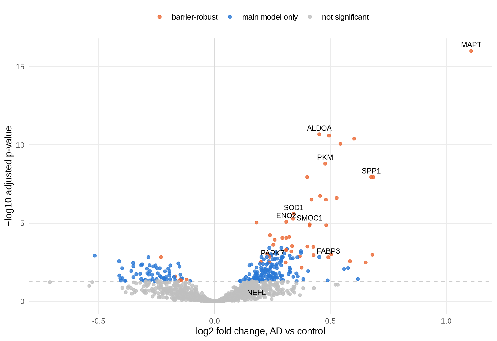
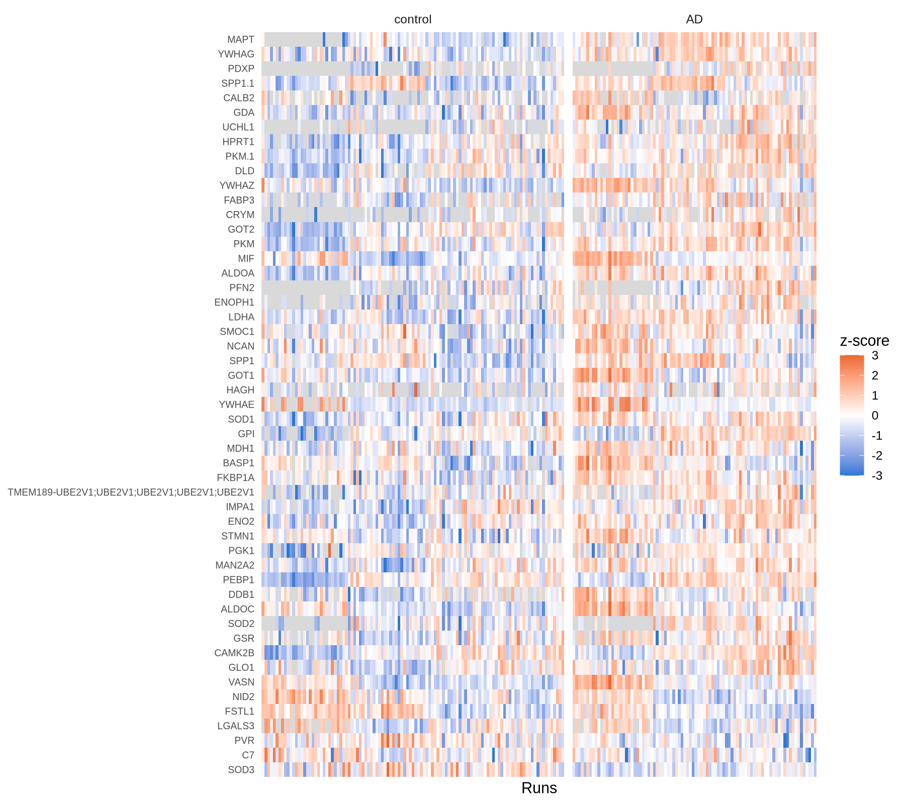
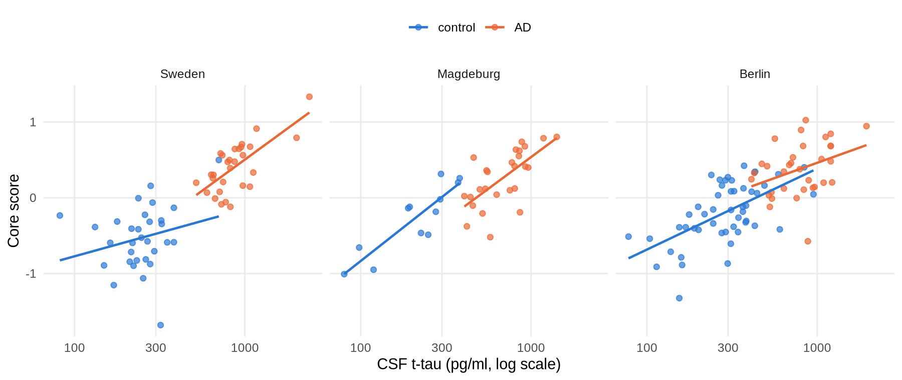
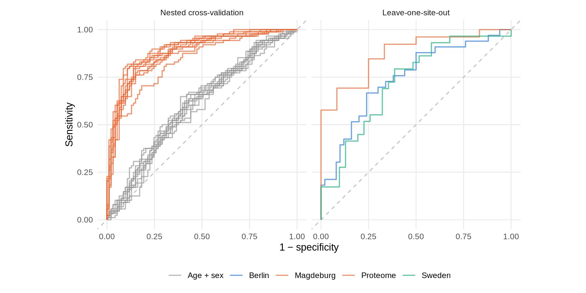

# What does Alzheimer's leave in the spinal fluid? A neuronal injury signature that tracks tau

*A reanalysis of the cerebrospinal fluid proteome of 197 people, from the raw
protein report to a validated classifier, including a test of how much of the
signal is already contained in the biomarkers that define the diagnosis.*

## The Question

Cerebrospinal fluid (CSF) bathes the brain, and what neurons and glia release
ends up there. Which proteins change in the CSF of people with Alzheimer's
disease (AD), and how much of that change is new information, rather than a
reflection of how the sample was taken, of how much blood plasma reaches the
fluid, or of the tau and amyloid measurements used to diagnose AD in the first
place?

This project reanalyzes a public mass spectrometry dataset (PRIDE PXD016278;
Bader et al., 2020) of CSF from three cohorts: 88 people with biochemically
defined AD and 109 controls.

## The Finding

**AD CSF carries a signature of neuronal injury.** Of 1,317 quantified protein
groups, 259 differ between AD and controls (FDR < 5%), most of them higher in
AD. A core of 50 survives every robustness check. It is dominated by
**glycolytic enzymes** (ALDOA, ALDOC, PKM, LDHA, GPI, ENO2, PGK1) and
**14-3-3 proteins** (YWHAZ, YWHAG, YWHAE), together with established CSF
markers such as SOD1, UCHL1, SMOC1 and SPP1. These are cytosolic proteins;
their presence in CSF most likely reflects release from damaged cells rather
than a change in metabolism.





**The signature tracks tau.** Diagnosis in this dataset requires high CSF tau
and low amyloid. The core rises with tau *within* AD and *within* controls,
with the same slope. After adjusting for tau, the AD effect on the core shrinks
by 83% and is no longer significant, and no individual core protein retains
it. There is no evidence that the signature follows amyloid beyond tau: it
reads as a marker of neurodegeneration, not of AD specifically.



## Is It Robust?

The main result holds with an alternative statistical model with sample
quality weights, without blood-contaminated samples and after renormalization
(r ≥ 0.96 between fold changes). Adjusting for the share of plasma proteins in
each sample reduces it to the 50-protein core. That adjustment is conservative:
the plasma share falls when brain proteins rise (r = −0.66 with the core
score), so it may remove part of the disease signal as well as barrier
effects. Results are reported in two tiers, and the core is a lower bound.

The original study's positive controls are recovered (SOD1, PARK7, and tau as
the strongest effect), and its glycolytic signature is found again. A clean
rerun of the full pipeline reproduced every result tier.

## Can It Diagnose?

An elastic-net classifier built only on the proteome (tau excluded) separates
AD from controls with an **AUC of 0.88** in nested cross-validation (95% CI
0.85–0.95 on averaged out-of-fold predictions), against 0.60 for age and sex
alone; at a 0.5 threshold, sensitivity is 0.81 and specificity 0.83. Trained on
two hospitals and tested on the third, it reaches 0.88, 0.74 and 0.73. Transfer
depends on how well the new hospital quantifies the model's proteins: once the
missing-value filter was correctly restricted to the training hospitals, one
cohort dropped from 0.86 to 0.73. Predicted probabilities are under-confident
and would need recalibration before being read as risks.

This should be read against the label itself: CSF t-tau and Aβ42 alone
reconstruct the diagnosis with an AUC of 0.98. The proteome learns an
approximation of a biomarker-defined label, largely through tau-related
neurodegeneration, and does not show diagnostic value beyond those biomarkers.
Its most stable predictors are the same 14-3-3 and glycolytic proteins as the
core, as expected from analyses of the same samples.



## How This Was Built

The analysis starts from the authors' Spectronaut protein report (DIA) and runs
in ten scripts plus two reports. Key decisions, each justified in
[METHODS.md](METHODS.md):

| Step | Decision |
|---|---|
| Sample QC | Batch offsets, blood contamination and plasma content measured per sample; outliers explained by covariates before any exclusion |
| Filtering | Lab contaminants removed; proteins kept if quantified in ≥ 50% of at least one group, which retains NEFL and UCHL1 |
| Missing values | Missingness depends on diagnosis, so it is modelled with proDA instead of imputed; imputation was shown to inflate effects |
| Model | `~ diagnosis + site + age + sex`; site separates an all-control cohort from the others |
| Classifier | Every step that uses the outcome learned inside training folds; validated across hospitals |
| Circularity | Added after a critical review: the core tested against the tau and amyloid measurements that define the diagnosis |

**Reports:** [QC report](https://sofiamucci.github.io/csf-proteomics-alzheimer-biomarkers/qc_report.html) ·
[Analysis report](https://sofiamucci.github.io/csf-proteomics-alzheimer-biomarkers/analysis_report.html)

**Results table:** [results/differential_abundance.csv](results/differential_abundance.csv),
with a [column dictionary](results/differential_abundance_dictionary.csv).

## Reproduce

Requires conda (or mamba) and Quarto.

```bash
mamba env create -f environment.yml
mamba activate csf-proteomics
R -e "renv::restore()"
bash run_pipeline.sh
```

`run_pipeline.sh` downloads the data from PRIDE, runs every step, renders both
reports and copies them to `docs/`, logging the git commit and software
versions.

## Repository Structure

```
├── run_pipeline.sh                 # runs everything, in order
├── scripts/
│   ├── 00_download_data.sh         # PRIDE download; records checksums
│   ├── 01_import.R                 # Spectronaut report -> matrix
│   ├── 02_annotate.R               # sample annotation, author exclusions
│   ├── 03_sample_qc.R              # per-sample metrics and contamination scores
│   ├── 04_filter.R                 # contaminants and valid-value filter
│   ├── 05_missing_value_methods.R  # observed vs imputed vs proDA
│   ├── 06_differential_abundance.R # main model and sensitivity analyses
│   ├── 07_export_results.R         # results table and dictionary
│   ├── 08_classifier.R             # elastic net, nested and cross-site validation
│   └── 09_circularity.R            # core signal vs CSF tau and amyloid
├── reports/                        # QC and analysis reports (Quarto)
├── docs/                           # rendered reports, served by GitHub Pages
├── results/                        # differential abundance results
├── figures/                        # figures used in this README
├── METHODS.md
├── environment.yml                 # R version (conda)
├── renv.lock                       # R package versions
└── LICENSE
```

## Limitations

- **Diagnosis is biochemical**, defined from CSF tau and amyloid with
  site-specific measures and thresholds. The core is explained mostly by tau;
  whether any protein carries AD-specific information beyond tau cannot be
  shown with this design, and the confidence interval does not exclude a small
  effect.
- **The plasma adjustment is ambiguous.** Without a CSF/serum albumin quotient,
  the plasma share cannot be classified as barrier permeability, part of the
  disease process, or a compositional effect of normalization.
- **No disease controls.** 14-3-3 proteins and glycolytic enzymes also rise in
  other neurodegenerative conditions; specificity for AD is not tested.
- **Cross-sectional data.** No staging or longitudinal analysis; the
  association with cognition (MMSE) is available in one cohort only and is
  exploratory.
- **Low-abundance proteins** such as NEFL are quantified near the detection
  limit by mass spectrometry; their absence from the results is not evidence
  of no change.
- **Site and measurement batch coincide**, so technical and collection effects
  cannot be separated.
- **No external cohort.** Cross-site validation uses cohorts from the same
  study and laboratory.

## AI-Assisted Development

This analysis was developed with Claude (Anthropic) as an assistant. I used it
to structure the pipeline, draft and debug R and Bash code, and discuss
methodological options, such as how to treat missing values, which covariates
to model and how to validate the classifier, and to run a critical review of
the finished analysis, which led to the circularity analysis and to a more
cautious interpretation. Each analytical decision was taken after examining
the data and is recorded with its justification in [METHODS.md](METHODS.md).
Code was run, checked against expected values (assertions in every script,
equivalence checks after refactoring, a clean end-to-end rerun) and reviewed
before committing. Where an expected result did not hold, the data prevailed
and the discrepancy is documented.

## Data Source

Bader JM, Geyer PE, et al. Proteome profiling in cerebrospinal fluid reveals
novel biomarkers of Alzheimer's disease. *Mol Syst Biol* 16:e9356 (2020).
[doi:10.15252/msb.20199356](https://doi.org/10.15252/msb.20199356). Data:
[PRIDE PXD016278](https://www.ebi.ac.uk/pride/archive/projects/PXD016278).

## License

MIT. See [LICENSE](LICENSE).
